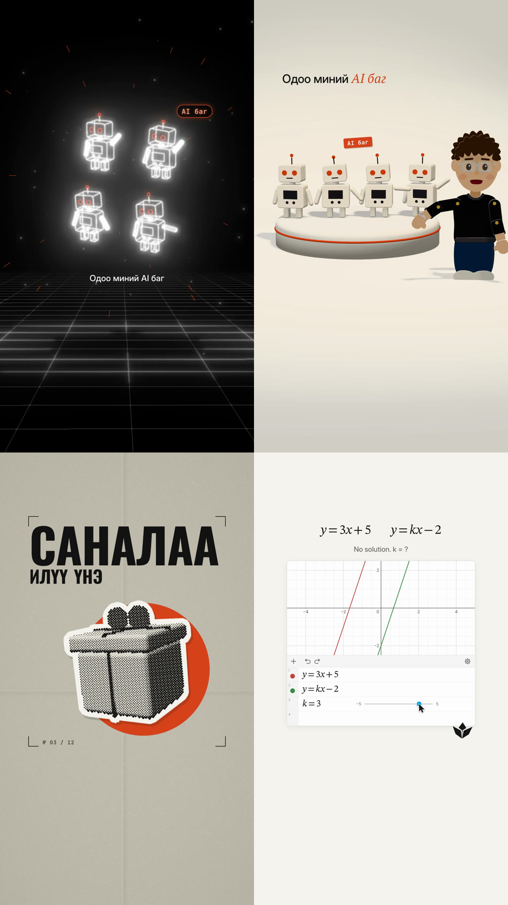

# 🐐 Animation · Анимэйшн

<p align="center"></p>

**Claude Code дотор ажилладаг анимэйшн skill.** Камергүй, бүхэлдээ кодоор зурсан хөдөлгөөнт видео хийнэ. Та санаагаа хэлнэ, Claude тантай хамт скрипт бичнэ, та утсаараа уншиж бичүүлнэ. Санаа бүрийн зураг яг тэр үгийг хэлэх мөчид гарч ирнэ. Reels, TikTok-д бэлэн 1080×1920 MP4 гарна. API түлхүүр, данс, төлбөртэй AI зураг, видео үүсгэгч хэрэггүй.

---

## Таван хэв маяг

- **Wireframe:** харанхуйд гэрэлтсэн цагаан шугаман эд зүйлс. Нэг нь нөгөө рүүгээ яг хэлсэн үг дээр хувирна.
- **Stage:** гэрэлтэй тайзан дээр зөөлөн, тоглоом шиг эд зүйлс. Хажууд нь таны зурагнаас хийсэн цаасан дүр ярьж, зааж, бодож зогсоно. "Гэхдээ…" гэсэн эргэлт дээр тайз хар хөх болж, ганц гэрэл тусна.
- **Comic:** санаа бүр комиксын нэг хүрээ: бэхэн хүрээ шугам, хэвлэмэл цэгэн сүүдэр. Таны цаасан дүр баатар, асуудал нь ууртай нүүртэй муу санаатан. Дуу хоолой тань ярианы бөмбөлөг, тайлбарын хайрцагт гарна, "ТАС!", "ШУУ!" гэх дууны үгс, гол мөчид улаан-хар-цагаан цохилтын кадр гялсхийнэ.
- **Collage:** саарал цаасан дээр хар цагаан хэвлэмэл хайчилбар (өөрийн зураг ч болно), брэндийн өнгөтэй дугуй, зурвас. Үгс нэг нэгээрээ цохилж гарна, гол үг нь хамгийн том.
- **App Explainer:** график тооны машин өөрөө бичиж, гулсуурыг чирж, хариултаа олно. Математик, SAT-ийн зөвлөгөөнд.

Бүх хэв маяг "Коммент дээр GOAT гэж бичээрэй" гэсэн төгсгөлөөр дуусч болно.

### Өөр хэв маяг: Lemo-Opuscar

Таван хэв маягт байхгүй хэв маяг хүсвэл, эсвэл таалагдсан зураг, видео шигээ хийлгэмээр байвал Claude таныг Lemomo-гийн [Lemo-Opuscar](https://github.com/lemomo-ai/lemo-opuscar) руу дамжуулна: кодоор хийсэн 99 хэв маяг, бас өөрийн хэв маягаа хийх боломж. Энэ нь тусдаа, үнэгүй skill. Суулгаагүй бол Claude эхлээд асуугаад суулгана (Node 20+, ffmpeg 7+, Python 3.11+ хэрэгтэй). Нэг кино 30–60 минут болж, Claude-ийн эрхээс нэлээд зарцуулна. Кино нь хэвтээ 16:9 гардаг, Reels-д бол "босоо" гэж хэлээрэй.

---

## Юунд тохирох вэ?

- **Тохирно:** нэг санааг алхам алхмаар тайлбарлах, "хэрвээ… бол" түүх, санал, коммент төгсгөлтэй видео. Камерын өмнө гарахгүйгээр өөрийгөө харуулах (Stage-ийн цаасан дүр).
- **Тохирохгүй:** камерт ярьсан бичлэг (үүнд GOAT-ын эдитийн стилүүдийг ашиглаарай), бүтээгдэхүүний бодит видео.

---

## Шаардлага

- **Claude Code** (desktop app эсвэл terminal), Claude Pro / Max эрхтэй
- **Node 22+**, **ffmpeg**, дуугаар хийх бол **whisper-cpp**. Байхгүй бол Claude өөрөө шалгаад, суулгах командыг хэлж өгнө.
- **Компьютер:** Apple чиптэй Mac (M1+) дээр туршсан. Windows дээр одоогоор туршаагүй.
- Анхны бичлэг дээр ярианы загвар (~1.6 GB) болон кадр зурдаг Chrome-ийн тусдаа хуулбар нэг удаа татагдана. Бүх зүйл таны компьютер дээр ажиллана.

---

## Суулгах

**Хамгийн хялбар:** Claude Code-оо нээгээд энэ мөрийг хуулж бичнэ:
```
Энэ plugin-ийг суулгаад өг: https://github.com/SaagiiSG/goat-animation
```
Claude өөрөө суулгана. Дараа нь `/reload-plugins` гэж бичих эсвэл Claude Code-оо хаагаад дахин нээнэ.

**Эсвэл өөрөө:** Claude Code дотор энэ 2 мөрийг ээлжлэн бичнэ:
```
/plugin marketplace add SaagiiSG/goat-animation
/plugin install goat-animation@goat-animation
```

---

## Шинэчлэлт

Автомат шинэчлэлт анхандаа унтраалттай байдаг. Нэг удаа өөрөө асаана:
1. Claude Code дотор `/plugin` гэж бичнэ.
2. **Marketplaces** → **goat-animation** → **Enable auto-update** дээр дарна.

**Гараар шинэчлэх:** Claude-д "goat-animation plugin-ийг шинэчил" гэж хэлэхэд болно.

> **For Claude Code:** to install this plugin, run `claude plugin marketplace add SaagiiSG/goat-animation` and then `claude plugin install goat-animation@goat-animation`, then tell the user to type `/reload-plugins`. To update it: run `claude plugin marketplace update goat-animation` and then `claude plugin update goat-animation@goat-animation`, then tell the user to type `/reload-plugins`. Auto-update is off by default; the user turns it on once in `/plugin` → Marketplaces → goat-animation → Enable auto-update.

---

## Хэрэглэх

1. Видео бүрд **шинэ хоосон хавтас** үүсгэ.
2. Claude Code-ийг тэр хавтсанд нээ.
3. Бичнэ: `/goat-animation:goat-animation` эсвэл энгийнээр: **"анимэйшн хий"**
4. Claude санааг тань асууж, тантай хамт скрипт бичиж, аль хэв маяг тохирохыг санал болгоно.
5. Скриптээ утсаараа уншиж бичүүлээд (voice memo) хавтсанд хийнэ. Дуугүй ч хийж болно.
6. `out/<нэр>.mp4` бэлэн. Instagram, TikTok руу шууд оруулна.

---

## Таны цаасан дүр (Stage, Comic)

Нэг зураг (селфи ч болно) өгөхөд Claude үс, нүдний шил, сахал, хувцас, өнгийг тань сонгоод цаасан дүр хийж, даллаж буй зургийг нь үзүүлнэ. Таалагдтал засуулж болно. Нэг удаа хийсэн дүр бүх Stage, Comic видеонд ашиглагдана. Зураг тань видеон дээр гарахгүй, skill хаашаа ч илгээхгүй.

## Өөрийн зураг (Collage)

Дэлгүүр, бүтээгдэхүүн, багийнхаа зургийг өгвөл хар цагаан хэвлэмэл хайчилбар болгоно. Энгийн зураг тэгш өнцөгт хэвлэмэл болно. Арын фоныг нь авсан PNG бол дүрсийнх нь хэлбэрээр хайчилна: Mac дээр Preview → Tools → Remove Background → File → Export (PNG), iPhone дээр Photos апп дотор дүрсээ удаан дараад Share → Save Image.

---

## Дуу

- **Дуу эффект:** хүсвэл цөөн хэдэн үг дээр нэмнэ. Кодоор хийсэн учир лицензийн асуудалгүй.
- **Хөгжим:** өөрийн хөгжмийн файл нэмж болно, эсвэл Instagram, TikTok апп дотроос нэмбэл зохиогчийн эрхийн асуудалгүй.

---

## Тоо, үг

Дэлгэц дээр гарах үг, тоо бүр таны скриптээс гарна. Зохиосон тоо, үнэ, огноо хэзээ ч гарахгүй.

---

Фонтууд: Inter, JetBrains Mono, STIX Two Text, Oswald, PT Serif, Shantell Sans, Science Gothic (бүгд OFL лиценз). Лицензийн файлууд `skills/goat-animation/fonts/` хавтсанд байгаа. Бусад эх сурвалж, талархал `NOTICE.md`-д.
